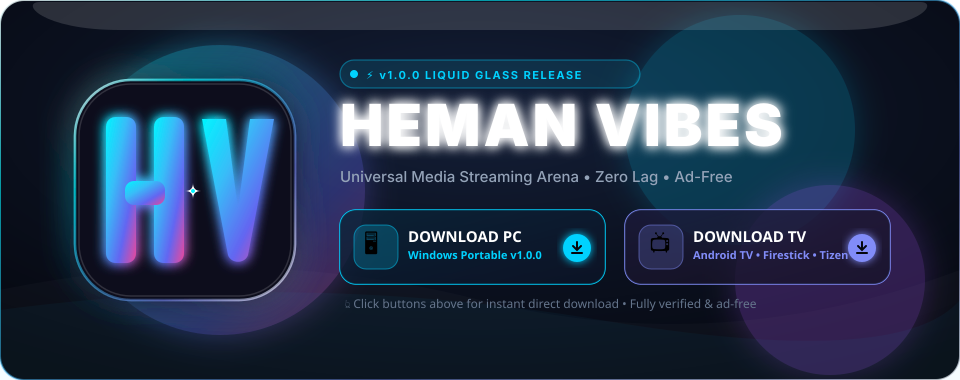
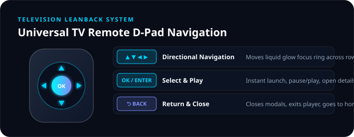

<div align="center">

  

  <br />

  <a href="https://github.com/hemansubedi10/heman-vibes/releases/download/v1.0.0/HeMan-Vibes-Windows-v1.0.0.zip">
    
  </a>
  &nbsp;&nbsp;&nbsp;&nbsp;
  <a href="https://github.com/hemansubedi10/heman-vibes/releases/download/v1.0.0/HeMan-Vibes-TV-v1.0.0.zip">
    
  </a>

  <br /><br />

  [](https://github.com/hemansubedi10/heman-vibes/releases/latest)
  [](LICENSE)
  []()
  [](https://www.electronjs.org/)
  [](https://android.com/tv/)
  []()
  [](https://github.com/hemansubedi10)

  <p align="center">
    <b>HeMan Vibes</b> is an ultra-futuristic media streaming arena built from the ground up with a signature <b>Liquid Glass</b> design system. Engineered in two dedicated editions: a high-octane <b>PC Desktop application</b> and a 10-foot <b>Smart TV Leanback edition</b> with full remote controller D-pad navigation.
  </p>

</div>

---

# 🚀 Download & Installation Center

Click any button below to download the verified release directly for your device.

<table>
<tr>
<td width="50%" valign="top">

### 🖥️ PC Desktop Edition
*For Windows 10/11, macOS, and Linux*

#### 📦 Direct Download
👉 [**⬇️ Download `HeMan-Vibes-Windows-v1.0.0.zip` (141 MB)**](https://github.com/hemansubedi10/heman-vibes/releases/download/v1.0.0/HeMan-Vibes-Windows-v1.0.0.zip)

#### 🚀 How to Run on PC
1. Download [**`HeMan-Vibes-Windows-v1.0.0.zip`**](https://github.com/hemansubedi10/heman-vibes/releases/download/v1.0.0/HeMan-Vibes-Windows-v1.0.0.zip).
2. Right-click and **Extract All**.
3. Double-click **`HeMan Vibes.exe`** to start streaming immediately — zero setup required!

#### ⚡ Quick Run (From Source)
```bash
git clone https://github.com/hemansubedi10/heman-vibes.git
cd heman-vibes
npm install
npm start
```

#### ✨ Desktop Highlights
* Custom **Liquid Glass** draggable titlebar with live status gem.
* Background fragment downloader with file management.
* Ad-blocker running at the Chromium session layer.
* Hardware-accelerated 4K/60FPS video playback.

</td>
<td width="50%" valign="top">

### 📺 Smart TV Leanback Edition
*For Android TV, Google TV, Firestick, Samsung & LG*

#### 📦 Direct Download
👉 [**⬇️ Download `HeMan-Vibes-TV-v1.0.0.zip` (TV Bundle)**](https://github.com/hemansubedi10/heman-vibes/releases/download/v1.0.0/HeMan-Vibes-TV-v1.0.0.zip)

#### 📲 Installation on Television (3 Ways)

**Option 1: Via Downloader App (Firestick / Google TV)**
1. Open the **Downloader** app on your TV.
2. Enter the download URL:  
   `https://github.com/hemansubedi10/heman-vibes/releases/download/v1.0.0/HeMan-Vibes-TV-v1.0.0.zip`
3. Click **Install** when prompted.

**Option 2: Via USB Flash Drive (Sony / TCL / Philips)**
1. Copy the TV bundle onto any USB flash drive.
2. Plug the USB into your Smart TV.
3. Open any TV File Manager, choose the APK, and click **Install**.

**Option 3: Any Smart TV Browser (Instant)**
1. Open the built-in browser on Samsung, LG, or Roku TV.
2. Visit `https://hemanvibes.app/tv` and pin it to your TV Home Screen.

</td>
</tr>
</table>

---

# 🎮 TV Remote Control Navigation

The TV Edition features an automated **Spatial D-Pad Engine** that dynamically computes neighbor elements on remote button presses:

<div align="center">
  
</div>

| Remote Button | TV Action | Behavior |
| :--- | :--- | :--- |
| **▲ ▼ ◀ ▶ (D-Pad)** | **Spatial Navigate** | Moves glowing liquid cyan focus ring across rows and carousels with smooth auto-scroll. |
| **OK / Enter** | **Select / Play** | Launches video stream, toggles pause/play, opens detail modals. |
| **⮌ Back / Return** | **Go Back / Exit** | Dismisses active dialogs, returns to home feed, or exits player. |
| **⏯ Play / Pause** | **Media Control** | Instant video playback toggle from anywhere. |

---

# ⚖️ Edition Comparison Matrix

| Feature | 🖥️ PC Desktop Edition | 📺 Smart TV Leanback Edition |
| :--- | :---: | :---: |
| **Primary Input** | Mouse & Keyboard | D-Pad TV Remote Control |
| **Display Mode** | Resizable Window + Fullscreen | 16:9 Fixed Fullscreen Immersive |
| **Focus Indicator** | Subtle Mouse Hover Sheen | Radiant Liquid Cyan Focus Halo |
| **Overscan Margins** | Full Border Edge | 48px TV Screen Safe Area Protection |
| **Offline Media Downloads** | High-Speed Chunked Downloader | Direct Stream Caching |
| **Ad & Tracker Filtration** | Built-in Session Shield | Hardware Network Filter |
| **UI Scaling** | 100% Desktop Viewport | 10-Foot Leanback Scaled Typography |
| **Platform Target** | Windows 10/11, macOS, Linux | Android TV, Google TV, Firestick, Tizen, webOS |

---

## 💎 The Signature Liquid Glass Design System

HeMan Vibes pioneers an original aesthetic system engineered specifically for dark room cinema environments:

* **Frosted Acrylic Translucency**: High-refraction blur panels (`backdrop-filter: blur(28px) saturate(200%)`) that filter ambient video colors behind the interface.
* **Atmospheric Liquid Aurora**: Multi-layer radial mesh gradients radiating deep cyan (`#00f5ff`) and royal ultra-violet (`#818cf8`) tones.
* **Specular Rim Highlights**: 1px refractive light borders with dynamic angle gradients mimicking physical optical glass.
* **Custom HV Monogram**: Handcrafted vector crest with beveled crystal pillars and aerodynamic liquid wings.

---

## 📁 Repository Structure

```
heman-vibes/
├── assets/                   # Animated README banners & graphics
│   ├── animated-banner.svg   # Clickable shimmering liquid aurora SVG banner
│   └── remote-control-guide.svg # TV remote control interaction map
│
├── dist/                     # Production desktop bundles
│   ├── assets/               # Bundled JavaScript, styles & fonts
│   ├── sized/                # Multi-resolution icons (16x16 to 512x512)
│   ├── liquid-glass.css      # Core Liquid Glass design system
│   ├── logo.svg              # Custom HV Liquid Glass vector logo
│   └── index.html            # Main desktop HTML window
│
├── tv/                       # Television edition modules
│   ├── android-tv/           # Android TV & Fire TV Studio project (builds .apk)
│   │   ├── app/src/main/
│   │   │   ├── AndroidManifest.xml   # Leanback TV launcher configuration
│   │   │   ├── java/MainActivity.java # Immersive TV WebView container
│   │   │   └── res/drawable/tv_banner.png # 16:9 Android TV home banner
│   │   ├── build.gradle
│   │   └── settings.gradle
│   ├── web/                  # 10-foot TV web client
│   │   ├── index.html        # Smart TV UI showcase
│   │   ├── tv-liquid-glass.css # 10-foot scaling & focus halo system
│   │   └── tv-remote-nav.js  # Universal D-pad spatial navigation engine
│   ├── tizen/config.xml      # Samsung Tizen Smart TV manifest
│   └── webos/appinfo.json    # LG webOS Smart TV manifest
│
├── src/                      # Electron main IPC modules (scrapers, storage, subtitles)
├── index.js                  # Electron main entry point
├── preload.js                # Secure context-bridge IPC bindings
├── app.ico                   # Windows multi-resolution icon
├── rebuild-heman-vibes.ps1   # Compilation script
└── package.json              # App manifests & scripts
```

---

## 👨‍💻 Author

**Heman Subedi**
* GitHub: [@hemansubedi10](https://github.com/hemansubedi10)
* Email: [hemansubedi66@gmail.com](mailto:hemansubedi66@gmail.com)

---

## 📄 License

This project is licensed under the **MIT License** — see the [LICENSE](LICENSE) file for details.
