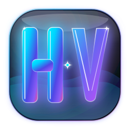

<div align="center">

  

  # HeMan Vibes

  **The Ultimate Liquid Glass Desktop Streaming & Media Powerhouse**

  [](LICENSE)
  [](https://www.electronjs.org/)
  [](https://react.dev/)
  [](https://github.com/hemansubedi10/heman-vibes)
  []()

  <p align="center">
    A next-generation desktop streaming application engineered for movies, TV series, and anime. Designed from the ground up with an ultra-futuristic <b>Liquid Glass</b> aesthetic, built-in session ad-blocking, and seamless offline media downloading.
  </p>

</div>

---

## ✨ Key Features

### 💎 Signature Liquid Glass UI
* **Frosted Acrylic Translucency**: Deep layered glass panels with real-time `backdrop-filter: blur(28px) saturate(200%)`.
* **Atmospheric Liquid Aurora**: Ambient electric cyan (`#00f5ff`) and ultra-violet (`#818cf8`) lighting radiating beneath frosted layers.
* **Specular Rim Highlights**: Handcrafted chromatic light catch borders mimicking physical optical crystal glass.
* **Fluid Interactive Controls**: Hover lifts, glowing neon badges, and floating glass pills for search, carousel navigation, and playback controls.

### 🎬 Streaming & Media Hub
* **Movies & TV Series**: Rich metadata discovery powered by TMDB integration.
* **Dedicated Anime Experience**: Direct episode management, skip intro support, and synchronized progress tracking.
* **Multi-Server Streaming**: Zero-lag playback with direct `.m3u8` and HLS streaming protocols.
* **Automated Subtitles**: Seamless multi-language subtitle retrieval and synchronization.

### 📥 Offline Downloads
* High-speed fragment-based media downloader with real-time speed, fragment tracking, and completion notifications.
* Integrated download manager with file location controls and watch status.

### 🛡️ Privacy & Ad-Free Architecture
* Hardware-level session request interceptor that automatically blocks tracking hosts, telemetry, and intrusive ad scripts before they execute.

---

## 🚀 Quick Start

### Prerequisites
* [Node.js](https://nodejs.org/) (v18 or higher)
* [npm](https://www.npmjs.com/) or [yarn](https://yarnpkg.com/)

### Installation

```bash
# Clone the repository
git clone https://github.com/hemansubedi10/heman-vibes.git

# Navigate to the project directory
cd heman-vibes

# Install dependencies
npm install

# Launch the desktop application
npm start
```

---

## 🛠️ Tech Stack

* **Core Runtime**: [Electron](https://www.electronjs.org/)
* **Frontend**: [React 18](https://reactjs.org/)
* **Styling**: Custom Liquid Glass Design System (`liquid-glass.css`) & CSS Variables
* **Networking**: IPC-based session management and streaming pipelines

---

## 📁 Project Structure

```
heman-vibes/
├── dist/                     # Production build assets & styles
│   ├── assets/               # Bundled JavaScript, styles & web fonts
│   ├── sized/                # Multi-resolution icons (16x16 to 512x512)
│   ├── liquid-glass.css      # Liquid Glass design system
│   ├── logo.svg              # Custom HV Liquid Glass vector logo
│   └── index.html            # Main HTML window template
├── src/                      # Electron main IPC modules
│   └── ipc/                  # Media scrapers, downloads, storage & subtitles
├── index.js                  # Main Electron entry point & window manager
├── preload.js                # Secure context-bridge IPC bindings
├── app.ico                   # Windows multi-resolution icon
├── rebuild-heman-vibes.ps1   # Quick compilation & packing script
├── package.json              # App manifests and metadata
└── README.md                 # Project documentation
```

---

## 👨‍💻 Author

**Heman Subedi**
* GitHub: [@hemansubedi10](https://github.com/hemansubedi10)
* Email: [hemansubedi66@gmail.com](mailto:hemansubedi66@gmail.com)

---

## 📄 License

This project is open-source under the [MIT License](LICENSE).
